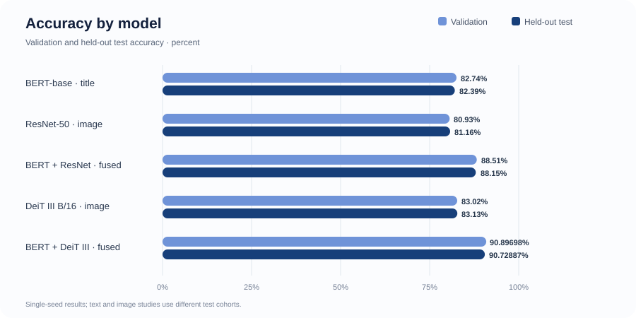

# Multimodal Fake News Detection

This Undergraduate Research Opportunities Programme (UROP) project compares how well a post’s title, its image, or both predict its six-class Fakeddit label. The strongest run combined BERT-base with DeiT III B/16 and achieved **90.73% held-out test accuracy** and **0.8616 Macro-F1**.

[Visit the project website](https://urop-research-project.vercel.app/)

## Results

| Model | Input | Validation accuracy | Held-out test accuracy | Test Macro-F1 | Test samples |
| --- | --- | ---: | ---: | ---: | ---: |
| BERT-base | Title | 82.74% | 82.39% | 0.7746 | 59,319 |
| ResNet-50 | Image | 80.93% | 81.16% | 0.6618 | 59,270 |
| BERT-base + ResNet-50 | Title and image | 88.51% | 88.15% | 0.8264 | 59,270 |
| DeiT III B/16 | Image | 83.02% | 83.13% | 0.7131 | 59,270 |
| BERT-base + DeiT III B/16 | Title and image | **90.90%** | **90.73%** | **0.8616** | 59,270 |

The first three runs establish the title-only, image-only, and multimodal baselines. The two DeiT III follow-ups improved on their respective baselines. On the same held-out image cohort, replacing ResNet-50 with DeiT III in the multimodal model improved test accuracy by **2.58 percentage points**. Macro-F1 gives all six classes equal weight. [Final BERT + DeiT III results](results/experiments/bert_deit3/final_results.json)

## Dataset and evaluation

The six Fakeddit categories used in this study are True, Satire/Parody, Misleading Content, Imposter Content, False Connection, and Manipulated Content. The models predict benchmark labels for posts. Fact-checking individual claims requires independent verification. [Fakeddit dataset](https://github.com/entitize/fakeddit) · [Original paper](https://arxiv.org/abs/1911.03854)

| Cohort | Training | Validation | Held-out test |
| --- | ---: | ---: | ---: |
| Title only | 564,000 | 59,342 | 59,319 |
| Image and multimodal | 563,601 | 59,299 | 59,270 |

The study retains the original splits. Image-based runs share the same cohort after excluding 491 records with unreadable images. The title-only run includes those records, so comparisons with it use slightly different cohorts.

The three baselines selected checkpoints by validation Macro-F1. The DeiT III follow-ups selected by validation accuracy. For the final multimodal run, the selected epoch 4 checkpoint was frozen before held-out evaluation. An independent check reproduced the metrics from the saved predictions.

## Repository

| Directory | Contents |
| --- | --- |
| [model/](model/) | Model definitions and training entry points for each input setup |
| [preprocessing/](preprocessing/) | Dataset preparation and manifests |
| [Training/](Training/) | Training scripts, cloud notebooks, and experiment support |
| [validation/](validation/) and [testing/](testing/) | Validation and held-out evaluation tools |
| [configs/](configs/) | Experiment settings and Python dependencies |
| [results/](results/) and [Metrics/](Metrics/) | Experiment outputs, verification records, and reporting utilities |
