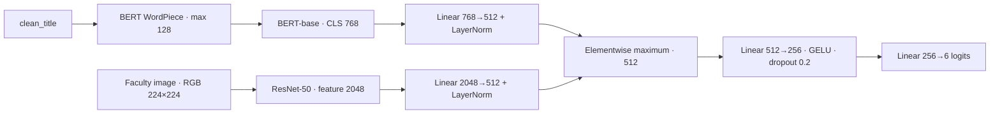

# Multimodal Part 1 — verified results

One registered four-epoch experiment, seed 42. **Epochs 1–2 and both full validations are complete.** Part 2 and final test inference have not started.

## Acceptance steps

- 4 — Passed actual T4 CUDA/AMP recovery and measured capacity. Exact interrupted/resumed fixture agreed; storage fix improved measured training from 10.13 to 57.40 pairs/s and reduced loader waiting from 84.80% to 0.25%.
- 5 — Completed epoch 1 on 563,601 pairs and validation on 59,299; saved/retrieved/reloaded checkpoints and independently recomputed all metrics.
- 6 — Resumed the same experiment; completed epoch 2 and a second full 59,299-pair validation.
- 7 — Independently verified predictions, six-class reports/confusions, selected weights and complete epoch 3 / cursor 0 recovery; local/private artifacts and project records preserved. Final Git proof is linked below.

## Faculty data

[Faculty dataset](https://drive.google.com/drive/folders/1DuH0YaEox08ZwzZDpRMOaFpMCeRyxiEF): original `multimodal_train.tsv`, `multimodal_validate.tsv`, `multimodal_test_public.tsv`. Original files, IDs, titles, split assignments and six labels are preserved.

| Split | Original TSV rows | Approved usable pairs | Documented exclusions |
|---|---:|---:|---:|
| Train | 564000 | 563601 | 399 |
| Validation | 59342 | 59299 | 43 |
| Public test, integrity only | 59319 | 59270 | 49 |
| Total | 682661 | 682170 | 491 |

The 491 strict decoding failures were explicitly approved for exclusion on 24 October. No further rows, difficult classes or duplicates were silently removed. All 682,170 images passed byte-hash and strict-decoding checks in the saved image gate; all 39 raw packs retain their original bytes.

The paper lists 682,996 multimodal samples, while the released TSVs total 682,661; the 335-row release discrepancy remains unresolved. Our approved usable cohort is 682,170. Exclusion class counts are retained in the pinned cohort registration; missing images are not assumed to be missing at random.

## Actual architecture and workflow

BERT-base-uncased is initialized from the verified selected text-only epoch 4 weights. ResNet-50 uses ImageNet1K V2 initialization. Both encoders are fine-tuned using the frozen multimodal configuration.

Workflow: verify immutable data/source hashes → restore model/optimizer/scheduler/scaler/RNG → train full epoch → full validation → export per-ID probabilities/loss → independently verify → private/local/Git backup → resume next epoch. No LR/sampler restart, resampling, test-driven selection or model substitution.

## Full validation metrics

| Metric | Paper six-way multimodal | Epoch 1 | Epoch 2 |
|---|---:|---:|---:|
| Accuracy | 86.0000% | 87.7064% | 88.3590% |
| Micro-F1 | Not reported | 0.877064 | 0.883590 |
| Macro-F1 | Not reported | 0.813183 | 0.822667 |
| Weighted-F1 | Not reported | 0.876182 | 0.882874 |
| Balanced accuracy | Not reported | 78.9108% | 80.1942% |
| Cross-entropy loss | Not reported | 0.499369 | 0.564860 |

Selected checkpoint: **epoch 2**, by validation Macro-F1, then lower loss, then earlier epoch. Each validation contains exactly 59,299 unique approved IDs.

Selected validation accuracy is **88.3590%**, **+2.3590 percentage points** versus the paper's 86.00%. The minimum +1-point validation aspiration is met. The paper's test accuracy is 85.88%; our final test is pending Part 2, with the registered 86.88% aspiration.

Source: [paper Tables 4–5](https://arxiv.org/html/1911.03854v2). Other aggregate metrics and class F1 are not reported; Table 6 gives test-class error proportions, which are not F1. Our cohort and fine-tuning procedure differ, so this is a numerical validation reference, not an exact paper replication or proof of a test improvement.

Epoch 2 improved accuracy and Macro-F1; its loss increased from 0.499369 to 0.564860. The registered Macro-F1 selection rule is retained.

## Six-class validation reports

### Epoch 1

| Class | Precision | Recall | F1 | Support |
|---|---:|---:|---:|---:|
| True | 0.881801 | 0.898628 | 0.890135 | 23320 |
| Satire/Parody | 0.798142 | 0.732386 | 0.763852 | 3520 |
| Misleading Content | 0.786707 | 0.822914 | 0.804403 | 11277 |
| Imposter Content | 0.838083 | 0.522617 | 0.643781 | 1238 |
| False Connection | 0.951023 | 0.944226 | 0.947612 | 17768 |
| Manipulated Content | 0.845346 | 0.813879 | 0.829314 | 2176 |

Raw and row-normalized 6×6 confusion matrices: `results/experiments/multimodal/OFFICIAL-6W-MM-USABLE-v2_seed42_20261027/validation_epoch1_confusions.json`, plus labelled CSV copies in the same folder.

### Epoch 2

| Class | Precision | Recall | F1 | Support |
|---|---:|---:|---:|---:|
| True | 0.878306 | 0.902787 | 0.890379 | 23320 |
| Satire/Parody | 0.829910 | 0.734659 | 0.779385 | 3520 |
| Misleading Content | 0.801501 | 0.833200 | 0.817043 | 11277 |
| Imposter Content | 0.826994 | 0.544426 | 0.656600 | 1238 |
| False Connection | 0.966095 | 0.947771 | 0.956845 | 17768 |
| Manipulated Content | 0.823084 | 0.848805 | 0.835747 | 2176 |

Raw and row-normalized 6×6 confusion matrices: `results/experiments/multimodal/OFFICIAL-6W-MM-USABLE-v2_seed42_20261027/validation_epoch2_confusions.json`, plus labelled CSV copies in the same folder.

## Comparison with preserved text-only results

On the same 59,299 usable validation IDs, saved text-only predictions give accuracy 82.7350% and Macro-F1 0.778672. Selected multimodal validation accuracy differs by +5.6240 points. This comparison performs no new model inference and preserves the original text results. The text model trained on 564,000 rows; multimodal uses 563,601. Filtered text loss cannot be reconstructed from confidence-only predictions and is not estimated.

## Cloud, recovery and evidence

- Kaggle private scientific jobs: [epoch 1](https://www.kaggle.com/code/rocky62/urop-mm-part1-science-usable-20261027) and [epoch 2](https://www.kaggle.com/code/rocky62/urop-mm-part1-science-epoch2-20261027), both Version 1. Two bounded jobs are one experiment, not two independent seeds.
- Recovery engineering fixture: random tiny BERT plus full random ResNet-50 on 13 synthetic pairs; same-T4 interrupted/resumed state difference was zero. The separate 600-second capacity measurement used the actual pretrained full model and real train images. This is not a cross-device bitwise reproducibility claim.
- Actual used GPU: Tesla T4, one CUDA-visible device 0. Kaggle allocated T4×2; the second device was not used for model training.
- Runtime: Python 3.13.15, PyTorch 2.11.0+cu128/CUDA 12.8, torchvision 0.26.0+cu128, Transformers 4.48.3, NumPy 2.1.3, Pillow 13.0.0; actual GPU Docker digest is in the final receipt.
- Observed account GPU quota at 2026-10-27T11:10:56.541106+00:00: used 6.4453h / total 30.0000h, reserved 0.0000h, remaining 23.5547h. All registered jobs are terminal COMPLETE.
- Recovery for Part 2: epoch 3, consumed cursor 0; model/BatchNorm, optimizer, four-epoch scheduler, AMP scaler, RNG, selection history and source/data contracts are present. Successful optimizer updates 35211; skipped AMP updates 15; total 35,226 registered boundaries.
- Latest recovery SHA256: `357c0707a80ef97f485cfe1824b537327aeb6810b89890055e6d18866e1f1819`; private/local tensor files are listed in `results/experiments/multimodal/OFFICIAL-6W-MM-USABLE-v2_seed42_20261027/private_large_artifact_manifest.json`.
- Large model tensors, original data/images and per-ID prediction exports stay in ignored local/private cloud storage. Git contains code, aggregate results, reports and checksums.
- Final backup proof: `results/MM_PART1_FINAL_GIT_BACKUP_20261027.json` (written after remote readback).

## Progress and next action

Part 1 package 100%. Text-only 100%; text + image 60%; image-only 20%; three-modality overall 60%. Multimodal training 2/4 and full validation 2/4; final test 0.

Part 2 starts from the verified epoch 3 / cursor 0 checkpoint of this SAME attempt and configuration. Read `context/MULTIMODAL_PART2_EXECUTION_PLAN_20261023.md` with the approved usable-cohort amendment. Finish remaining registered training/validation, select by the frozen validation procedure, then perform the authorized one-time final public test and independent reporting. Part 2 and image-only were not run here.
